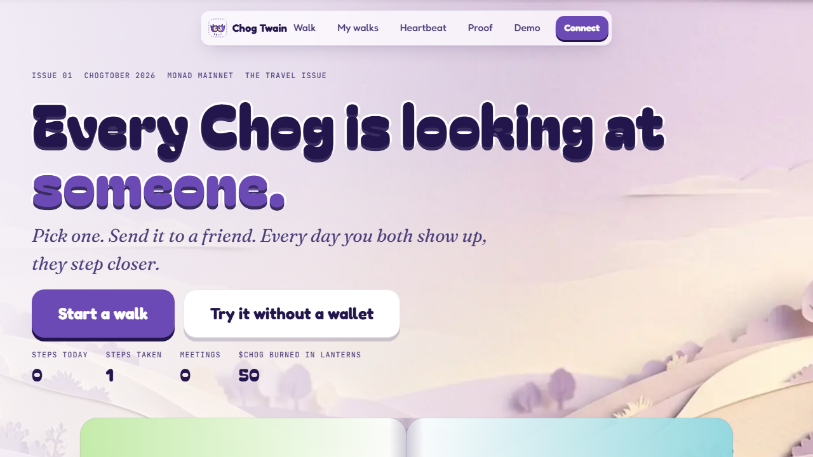
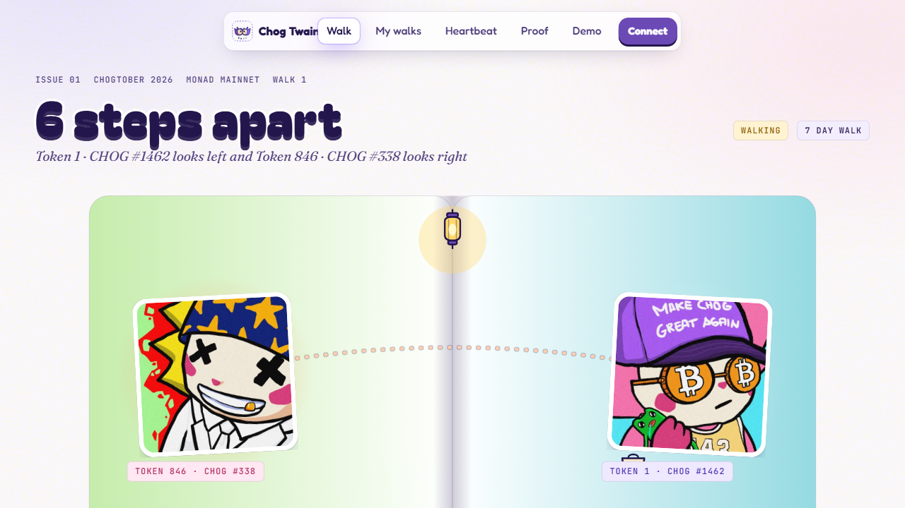
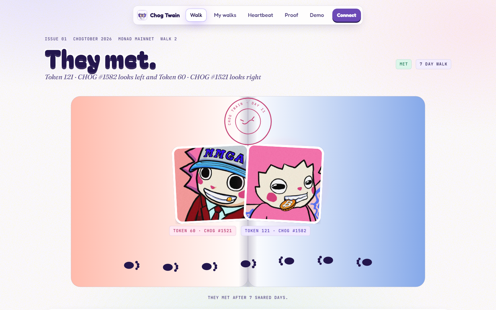
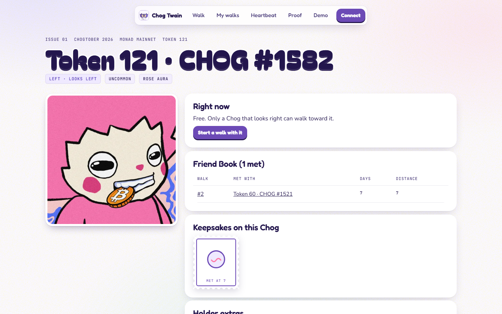
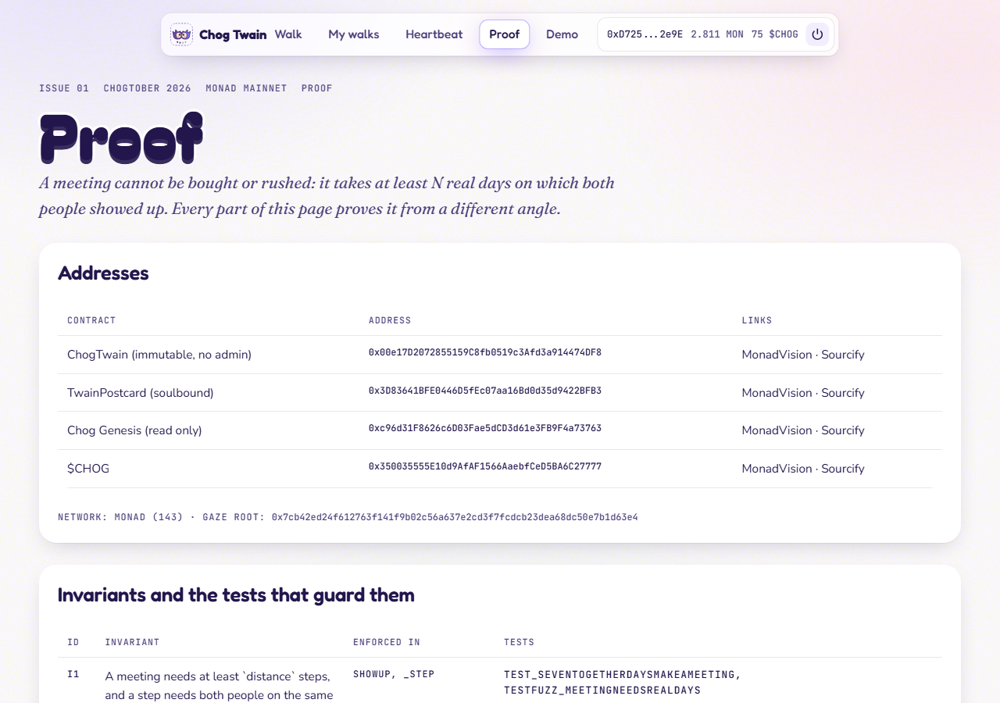
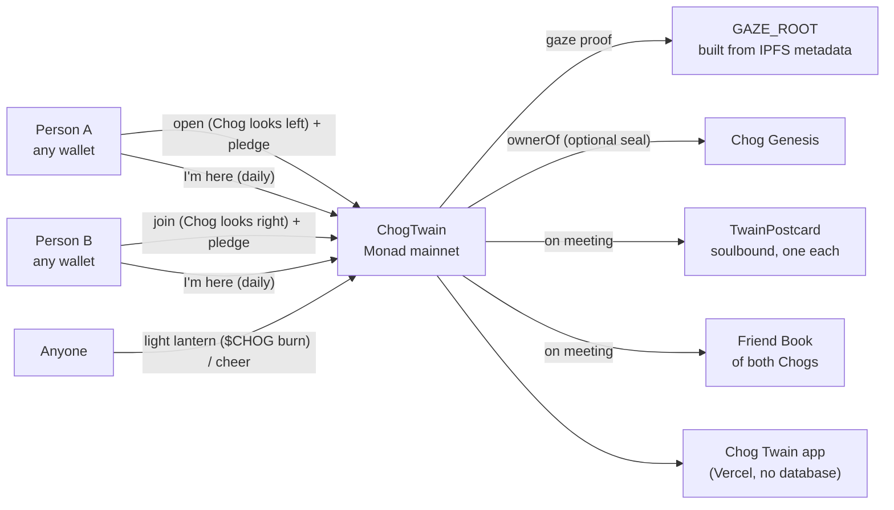
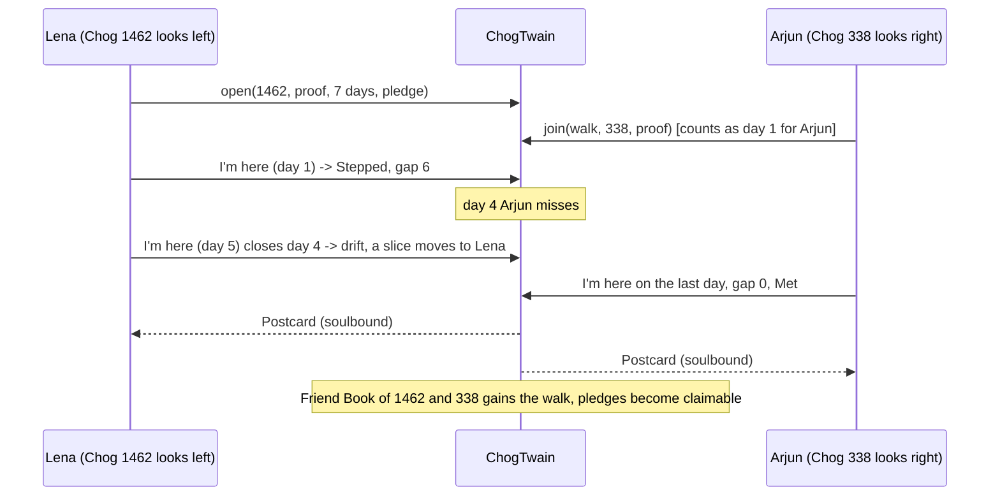

<p align="center"></p>

<p align="center">
  <a href="https://chog-twain.vercel.app"></a>
  <a href="https://monadvision.com/address/0x00e17D2072855159C8fb0519c3Afd3a914474DF8"></a>
  <a href="https://repo.sourcify.dev/contracts/full_match/143/0x00e17D2072855159C8fb0519c3Afd3a914474DF8/"></a>
  <a href="https://chogathon.chog.xyz"></a>
  <a href="#measured"></a>
</p>

<h3 align="center">Every Chog is looking at someone.</h3>

**Lena in Leipzig and Arjun in Pune (both fictional) promised to keep in touch and slowly stopped. Chog Twain gives two friends like them two Chogs that look at each other, steps the Chogs closer on every UTC day both of them show up, and writes the meeting onto both Chogs forever.**

<p align="center"></p>

| | |
|---|---|
| **Live app** | https://chog-twain.vercel.app (the Demo needs no wallet; any wallet with a little MON runs the real thing; no Chog needed) |
| **A real walk, right now** | [walk 1 on Monad mainnet](https://chog-twain.vercel.app/w/1): token 1 and token 846, one step walked, a lantern lit |
| **60-second judge walk** | [/judge](https://chog-twain.vercel.app/judge) |
| **Video** | 2:50, link added at submission |
| **Contracts** | [`ChogTwain`](https://monadvision.com/address/0x00e17D2072855159C8fb0519c3Afd3a914474DF8) and [`TwainPostcard`](https://monadvision.com/address/0x3D83641BFE0446D5fEc07aa16Bd0d35d9422BFB3) on Monad mainnet, both verified on Sourcify |
| **Category** | Social |
| **Measured** | [FACTS](#measured): walks, steps, meetings, lanterns, $CHOG pledged and burned, tests, latency |

## Deployed contracts

Monad mainnet (chain 143), deployed 21 Oct 2026, both verified on Sourcify. Immutable: no owner, no admin, no pause, no upgrade.

| Contract | Address | Explorer | Sourcify |
|---|---|---|---|
| **ChogTwain** (the rulebook) | `0x00e17D2072855159C8fb0519c3Afd3a914474DF8` | [MonadVision](https://monadvision.com/address/0x00e17D2072855159C8fb0519c3Afd3a914474DF8) | [verified](https://repo.sourcify.dev/contracts/full_match/143/0x00e17D2072855159C8fb0519c3Afd3a914474DF8/) |
| **TwainPostcard** (soulbound, ERC-5192) | `0x3D83641BFE0446D5fEc07aa16Bd0d35d9422BFB3` | [MonadVision](https://monadvision.com/address/0x3D83641BFE0446D5fEc07aa16Bd0d35d9422BFB3) | [verified](https://repo.sourcify.dev/contracts/full_match/143/0x3D83641BFE0446D5fEc07aa16Bd0d35d9422BFB3/) |
| Chog Genesis (read only, never written) | `0xc96d31F8626c6D03Fae5dCD3d61e3FB9F4a73763` | [MonadVision](https://monadvision.com/address/0xc96d31F8626c6D03Fae5dCD3d61e3FB9F4a73763) | not ours |
| $CHOG (pledges and lanterns) | `0x350035555E10d9AfAF1566AaebfCeD5BA6C27777` | [MonadVision](https://monadvision.com/address/0x350035555E10d9AfAF1566AaebfCeD5BA6C27777) | not ours |

Fixed at deploy and readable on the contract: gaze root `0x7cb42ed24f612763f141f9b02c56a637e2cd3f7fcdcb23dea68dc50e7b1d63e4`, lantern price **50 $CHOG**, deploy block 115,427,898. The gaze root is the same value that `node scripts/verify.mjs` rebuilds from the collection on your machine.
<table>
  <tr>
    <td width="50%"><br><sub><b>A walk, mid-way.</b> Walk 1 on Monad mainnet: the right-facer stands on the left page, the left-facer on the right, a lantern hangs at the fold.</sub></td>
    <td width="50%"><br><sub><b>The meeting.</b> Postmark, soulbound postcards, Friend Books. Captured on the seeded local test chain: a real meeting needs 7 real UTC days.</sub></td>
  </tr>
  <tr>
    <td width="50%"><br><sub><b>A Chog remembers.</b> Its Friend Book lists every walk it finished, read from contract storage (local test chain).</sub></td>
    <td width="50%"><br><sub><b>Proof.</b> Addresses, Sourcify links, the 15 invariants with their test names, gas and which RPC answered (mainnet).</sub></td>
  </tr>
</table>

## The story

Lena is a night-shift pharmacist in Leipzig. Her best friend from university, Arjun, a product designer, moved back to Pune. For a month they kept in touch. Then the messages got shorter, then weekly, then birthdays only.

Lena picks Chog #1462 (it looks left, wearing BTC glasses) and sends Arjun a link. He picks Chog #338 (it looks right) and joins. The day closes at 00:00 UTC: 02:00 in Leipzig, 05:30 in Pune. Lena taps **I'm here** after her shift at 22:40. Arjun taps with his first chai at 07:10. Whoever arrives second sees both Chogs step closer.

On day four Arjun forgets. The Chogs drift apart and a slice of his pledge moves to Lena. That night he sends her a voice note. On day nine they meet. Both get a postcard. Both Chogs remember. They start a 30-day walk.

Lena's sister has no Chog and no pledge. She lights a lantern for them with $CHOG, and the night Arjun's flight is delayed, the lantern keeps the day. And Mei, in Osaka, owns Chog #338. She never knew. One morning she opens its Friend Book and sees that her Chog has met eleven friends this month, walked by people she has never met.

## The problem

An NFT's only verb is "sell", and daily "gm" engagement is empty and easy to fake. People already keep small daily rituals with someone, but the tools have no reason and no keepsake.

| What is true | Number | Source |
|---|---|---|
| A daily habit with a friend raises completion | Friend Streak learners are 22% more likely to complete their daily lesson | [Duolingo, 20 Sep 2024](https://blog.duolingo.com/product-lessons-friend-streak/) |
| Short streaks predict staying | A 7-day streak makes learners 3.6x more likely to complete their course | [Duolingo, 31 Jan 2022](https://blog.duolingo.com/how-duolingo-streak-builds-habit) |
| NFTs sit idle while volume collapses | NFT volume $823M in Q2 2025 vs $4B a year earlier | [DappRadar via Decrypt, 4 Jul 2025](https://decrypt.co/328668/cheaper-nfts-mean-sales-are-surging-but-trading-volume-is-plummeting) |
| Reading history in a browser on Monad is impractical | 300 ms blocks = 288,000 blocks a day; public RPCs return logs 100 blocks per call = 2,880 calls for one day | [Monad docs](https://docs.monad.xyz/reference/rpc-differences) and our own measurement in [DISCOVERY.md](DISCOVERY.md) |

We did not quote the commitment-contract literature, because we have not opened the paper. See [MOMENT.md](MOMENT.md).

## The discovery

Every Chog already looks at someone. Its face points left, right, or straight out of the frame, and the collection is lopsided. We rebuilt the numbers ourselves from the chain and IPFS (all 1,969 `tokenURI`s through Multicall3, every metadata file hashed):

| Looks left | Looks right | Looks at you | Most walks at once | Right-facers always waiting |
|---|---|---|---|---|
| <!-- FACTS:gaze-left -->650<!-- /FACTS:gaze-left --> | <!-- FACTS:gaze-right -->1,309<!-- /FACTS:gaze-right --> | <!-- FACTS:gaze-front -->10<!-- /FACTS:gaze-front --> | <!-- FACTS:max-walks -->660<!-- /FACTS:max-walks --> | <!-- FACTS:right-waiting -->649<!-- /FACTS:right-waiting --> |

If two Chogs must face each other to meet, at most 660 walks can run at once and 649 right-facing Chogs are always waiting for a partner. The trait nobody used becomes the rule of the whole world. It lives in IPFS metadata, not on-chain, so the contract is shown a **Merkle proof** against a root fixed at deploy (<!-- FACTS:gaze-root -->`0x7cb42ed24f612763f141f9b02c56a637e2cd3f7fcdcb23dea68dc50e7b1d63e4`<!-- /FACTS:gaze-root -->) that anyone can rebuild.

## What Chog Twain does

1. **Pick.** Choose any of the 1,969 Chogs. You do not need to own it. Filter by gaze, aura or head; only Chogs that look the right way can join your walk.
2. **Walk.** Send the link. Your friend joins with a Chog that faces yours. The two Chogs start apart, 7, 14 or 30 steps.
3. **Show up.** Each of you taps **I'm here** once per UTC day, with an optional 28-byte note. The moment the second person arrives, the contract takes the step in the same transaction.
4. **Drift.** A day one of you misses, the Chogs drift one step apart (steps already walked are never taken back) and a slice of the absent person's pledge goes to the one who came. Three unkept days in a row and the walk ends.
5. **Meet.** When the gap reaches zero, in that same transaction: both Friend Books are written, two soulbound postcards are minted, pledges are settled, both Chogs are free to walk again.

Anyone can **light a lantern** (burns $CHOG, keeps a day only one of you made, never a day nobody came) or **cheer** (free). A 1:1 legendary looks straight out and can meet anyone.

## What the meeting leaves

- **Both Chogs remember.** The Friend Book of each Chog lists every walk it finished, with whom and how long it took. It follows the token if it is sold, and any app can read it.
- **A postcard each.** Printed fully on-chain, with an SVG drawn inside `tokenURI`, and soulbound (ERC-5192): it cannot be sold or moved.
- **Your pledge comes back**, minus a slice for each day you missed.
- **A meeting card** to share: a 1200 by 630 image of the two artworks, with the day count and a block number that is shown only after one `eth_getLogs` over exactly that block confirms it.
- **The next walk**, further, with the same friend or someone new.

## Explore in 2 minutes

| You are | Do this |
|---|---|
| A judge with no wallet | Open [/demo](https://chog-twain.vercel.app/demo): open a walk, friend joins, I'm here, friend shows up, a missed day, a lantern, walk it all the way to a meeting. Then **Break a rule** to see every contract error as a sentence |
| Any wallet with a little MON, no Chog | [/walk/new](https://chog-twain.vercel.app/walk/new): filter by gaze, pick a Chog, open. Watch **Landed in block N (proposed)** become **Postmarked. Final in X.X s.** Join from a second wallet; light a lantern from a third |
| A Chog holder | Open your Chog's page: you get a **keeper's seal** and a **home only** switch, read live from `ownerOf`. Sell the Chog and the new holder holds the key |
| A skeptic | [/proof](https://chog-twain.vercel.app/proof), then `node scripts/verify.mjs` |

## Why the Chog is essential

Take the NFT out and the product does not exist. Take each part out in turn:

| Take away | What breaks |
|---|---|
| The gaze (`Side` trait) | Nobody can face anybody; `canMeet` has nothing to compare; the scarcity disappears |
| The art | No two characters on the page; no meeting scene, no card |
| The token id | No Friend Book; a meeting belongs to nothing that lasts |
| The one-walk-per-Chog lock | Every Chog is infinite; picking one means nothing |
| Live `ownerOf` | No keeper's seal, no "home only" (an optional layer only) |
| $CHOG | No pledges, no lanterns; the walk still works (the bonus layer, as the rules intend) |
| Monad | The rules would run on any EVM chain. Monad makes a daily on-chain tap cost a fraction of a cent and lets the second arrival land in about a second |

## How it works



```text
Browser (Next.js on Vercel)                         Monad mainnet (143)
+----------------------------------------+          +--------------------------------------+
| Landing, Walk, Open, Chog, Heartbeat,  |  reads   | Chog Genesis (ERC-721, read only)    |
| Proof, Judge, Demo                     |--------->|   ownerOf (only for optional seals)  |
| wagmi + viem, our own wallet modal     |          |                                      |
| rules engine (same rules as contract)  |  writes  | ChogTwain (immutable, no admin)      |
| two-stage confirm: proposed, finalized |--------->|   walks, gaze, locks, Friend Books,  |
+-------------------+--------------------+  user's  |   pledges, lanterns, heartbeat       |
                    |                      wallet   |   TwainPostcard (soulbound, on-chain)|
                    | static files         signs    | $CHOG (ERC-20): pledges, burn dEaD   |
                    v                               +--------------------------------------+
   data/collection.json, data/gaze.json  (built from chain + IPFS by script; root on-chain)
   /api/art/[tokenId]  (IPFS proxy, cache, gateway fallback)    /api/card/[walkId]  (meeting card)
```



There is **no database, no server of record and no admin**. Only two stateless routes exist: an art proxy and a card renderer. Every page renders from contract views (`walk`, `preview`, `walksOf`, `openWalks`, `friendBook`, `activeWalkOf`, `stepsOnDay`, counters) batched through Multicall3; events are for audit and the verifier.

## Anatomy of a day

Days are resolved lazily, in constant time per action: the first action of a new UTC day closes the days before it. There is no keeper, no cron and no server. This table is the whole rulebook for a walking pair:

| What happened on the day | Result | Pledge | Counts as kept |
|---|---|---|---|
| Both showed up | **Step**: gap minus one, in the transaction of the second arrival | none moves | yes |
| One showed up, a lantern is stored | The lantern is used up; no drift | none moves | yes |
| One showed up, no lantern | **Drift**: gap plus one (never beyond the distance) | `pledge / distance` moves from the absent person to the other | no |
| Nobody showed up | Drift | nothing moves: the two slices would cancel | no |
| Three unkept days in a row | The walk ends: **Apart**, both Chogs are free | settled as above | no |
| Someone walks away | The walk ends now | the leaver forfeits the whole pledge to the friend | no |

`preview(walkId)` returns the walk exactly as the next transaction will leave it, so the page shows pending drift before anyone pays for it to be written.

## Design decisions that make it hold up

- **Scarcity comes from the art, not from a counter.** A Chog walks with one pair at a time, world-wide, and only facing Chogs can meet. That turns the gaze into a market-less scarce resource without the contract ever touching the NFT.
- **Nobody custodies anything they do not own.** The contract never asks for an NFT approval and never holds a token. Pledges and lanterns are the only funds, they are pulled with an exact `approve`, and payouts are by pull (`claim`), so there is no push to a hostile address.
- **The ledger is small on purpose.** Everything a daily show-up touches lives in one packed struct, the latest note per walker is stored so a browser can read it, and counters feed the Heartbeat. Pages render from storage views batched through Multicall3; no page scans logs, because Monad public RPCs cap logs at 100 blocks per call.
- **One rulebook, two implementations.** The contract and `packages/rules` (TypeScript) are checked against the same 18 hand-written scenarios, and `preview()` is checked against both. The Demo, the verifier and the live page therefore cannot disagree about what a rule means.
- **Everything is labelled for what it is.** The Demo says Demo. Fictional people say fictional. Screenshots of a finished meeting say they come from a local chain, because a real meeting needs real days.

## Threat model

| Threat | What stops it |
|---|---|
| Rushing a meeting (two wallets, many calls in one day) | At most one step per walk per day (`stepped`, `AlreadyToday`); a meeting needs at least `distance` steps (I1, I2) |
| Forging a Chog's gaze to pick any partner | Merkle proof against the immutable `GAZE_ROOT`; a forged side reverts `BadProof` (reverted on mainnet) |
| Claiming a stranger's Chog is busy or free | `activeWalkOf` is the single lock; invariant I6 over random sequences |
| Draining pledges | Conservation invariant I9: contract balance equals active pledges plus claimable balances, checked by fuzz, invariant runs and 300 randomised engine runs |
| A hostile or unwilling friend | Anyone can `poke` a stale walk; three unkept days end it; a lantern from a stranger can keep a day |
| Reentrancy and push payments | Pull-only `claim`; pledge state is settled before any transfer |
| Admin or upgrade risk | None exists: no owner, no proxy, no pause; verified source |
| One person, two wallets | Not prevented, by design: it only records their own walk, and pledges only move their own $CHOG |

## Verification trail

Run these and compare with what this page says. Each command proves one thing.

```bash
(cd contracts && forge test)          # 15 invariants, fuzz, soulbound, tokenURI decoding, proof parity
npm test                              # TypeScript twin and the 18 shared scenarios
node scripts/verify.mjs               # gaze root vs the contract, metadata sha256, every walk replayed, postcards decoded
node scripts/check-no-nft-writes.mjs  # the only call on Chog Genesis is ownerOf
node scripts/e2e.mjs                  # real transactions through the real UI on a local chain, 9 viewports, axe
```

The first real walks, with their transaction links, are in [EVIDENCE.md](EVIDENCE.md): an open, a join with a 25 $CHOG pledge each, a day-one step with a note, a lantern and a cheer from a wallet that owns no Chog, and six deliberately reverted guard transactions. Demo footage recorded from the real flows (1280x800 video, with the specs and a scene-by-scene guide) is in [docs/playwright_outputs_for_demo](docs/playwright_outputs_for_demo).
## The promise, in code

> **A meeting cannot be bought or rushed: it takes at least N real days on which both people showed up.**

| ID | Invariant | Test |
|---|---|---|
| I1 | A meeting needs at least `distance` steps, and a step needs both people on the same UTC day | `test_sevenTogetherDaysMakeAMeeting`, `testFuzz_meetingNeedsRealDays` |
| I2 | At most one step per walk per day | `test_aMeetingCannotBeRushed` |
| I3 | Only the two walkers can show up | `test_strangerCannotShowUp` |
| I4 | A wallet cannot walk with itself | `test_oneWalletCannotWalkWithItself` |
| I5 | Only Chogs that look at each other can meet; gaze must match the published root | `test_onlyChogsThatLookAtEachOtherCanMeet`, `test_forgedGazeReverts`, `GazeProofCompat` |
| I6 | A Chog walks with one pair at a time, world-wide | `test_aChogWalksWithOnePairAtATime`, `invariant_noChogInTwoActiveWalks` |
| I7 | A missed day drifts; steps walked are never taken back; three unkept days end the walk | `test_aMissedDayDriftsThemApart`, `test_threeUnkeptDaysPartThemForGood` |
| I8 | A lantern keeps only a day on which exactly one person came; max 3 | `test_lanternKeepsADayOnlyOneCameTo`, `test_lanternNeverCoversADayNobodyCame`, `test_lanternsCapAtThree` |
| I9 | Every $CHOG is accounted for | `testFuzz_meetingNeedsRealDays`, `invariant_chogConserved` |
| I10 | A missed day costs only the one who missed it; walking away costs the whole pledge | `test_aMissedDayCostsTheOneWhoMissedIt`, `test_leaveBeforeAnyMiss` |
| I11 | Postcards cannot move | `test_postcardIsSoulbound` |
| I12 | Holder extras follow the token | `test_holderSealAndHome`, `test_homeFollowsTheTokenAfterASale` |
| I13 | Nobody needs to own a Chog | `test_nobodyNeedsToOwnAChog` |
| I14 | The contract never writes to Chog Genesis | `test_noNftWrites`, a CI grep |
| I15 | `preview` equals what the chain will do | `test_previewMatchesWhatTheChainWillDo` |

**The fuzz finding.** Because a missed day reopens the gap, a meeting takes **at least** N steps, not exactly N, and a pair that alternates can walk forever. The fuzzer found a counterexample at 16 steps for a distance of 14, so the rule is stated as "at least", and the test keeps asserting it. A TypeScript twin of the contract (`packages/rules`) runs the same 18 hand-written scenarios as the Solidity tests; if the two ever disagree, CI fails.

## Monad, specifically

- **300 ms blocks and finality stages in the UX.** Every write shows two stamps: *Landed in block N (proposed)*, then *Postmarked. Final in X.X s.* On mainnet we measured a median of <!-- FACTS:latency-proposed -->1171 ms median (20 samples, Monad mainnet)<!-- /FACTS:latency-proposed --> to proposed and <!-- FACTS:latency-final -->2013 ms median (20 samples, Monad mainnet)<!-- /FACTS:latency-final --> to final.
- **Gas is charged by limit, not by use.** We measured it on mainnet: a receipt's gas used equals the gas limit we sent, so a tight limit is real money. The same `cheer` cost 30% less with our measured limit than with a generous wallet-style one ([EVIDENCE.md](EVIDENCE.md)). The app sends the larger of the measured limit and 1.25 times the live estimate, so it never runs out of gas.
- **Logs are limited to 100 blocks per call and a Monad day is 288,000 blocks**, so no page scans logs. State lives in packed storage views read through Multicall3 in batches of 200. The latest note per walker is stored for the same reason.
- **Packed storage (MIP-8).** The fields a daily show-up touches share one struct. An ablation contract with every field in its own mapping is in `contracts/src/ablation`; its Monad-testnet comparison is not run yet and is marked UNKNOWN in [DISCOVERY.md](DISCOVERY.md).
- **Not used, so not claimed:** EIP-7702, the P256 precompile, `eth_sendRawTransactionSync`, the execution events SDK, staking. See [MONAD_SURFACE.md](MONAD_SURFACE.md) for file and line of everything that is used.

## $CHOG

- **Pledges are a commitment contract between two people.** Equal amounts, escrowed, settled on meeting or ending, claimable by pull. A missed day moves `pledge / distance` from the absent person to the one who came. The contract's balance always equals active pledges plus claimable balances; an invariant test and 300 randomised engine runs check it.
- **Lanterns burn $CHOG** to `0x...dEaD`, so they reduce supply. The price is fixed forever at **50 $CHOG** (about US$0.075 at deploy). Anyone can light one for any walk, with no Chog and no walk of their own.
- Live totals (pledged, burned, moved by missed days) are on the [Heartbeat](https://chog-twain.vercel.app/heartbeat), read from storage. Now: <!-- FACTS:pledged -->70 $CHOG<!-- /FACTS:pledged --> pledged, <!-- FACTS:lanterns -->1<!-- /FACTS:lanterns --> lantern(s) lit.

## Measured

Every number below is generated from `docs/FACTS.json` or read live. Nothing is typed by hand, and CI fails if this file drifts from the facts.

| | |
|---|---|
| Foundry tests | <!-- FACTS:forge-tests -->42 passing, 0 failing<!-- /FACTS:forge-tests --> (includes a <!-- FACTS:fuzz-runs -->512<!-- /FACTS:fuzz-runs -->-run fuzz and an invariant suite of six actors) |
| Rules engine tests | <!-- FACTS:vitest-tests -->33 passing, 0 failing<!-- /FACTS:vitest-tests --> |
| Browser tests | <!-- FACTS:playwright-tests -->146 passing, 0 failing, 4 skipped<!-- /FACTS:playwright-tests --> |
| Lighthouse, mobile, live `/` | accessibility 100, best practices 100, SEO 100, performance 67 (LCP 5.0 s, TBT 524 ms under Lighthouse's slow-phone throttling; the wallet stack hydrating on first load is the known cost, see [PROGRESS.md](PROGRESS.md)) |
| Walks opened on mainnet | <!-- FACTS:walks -->3<!-- /FACTS:walks --> |
| Steps taken | <!-- FACTS:steps -->2<!-- /FACTS:steps --> |
| Meetings | <!-- FACTS:meetings -->0<!-- /FACTS:meetings --> |
| Reverted guard transactions on mainnet | <!-- FACTS:break-count -->6<!-- /FACTS:break-count --> |
| Gas limits sent | open <!-- FACTS:gas-open -->370,000<!-- /FACTS:gas-open -->, join <!-- FACTS:gas-join -->223,000<!-- /FACTS:gas-join -->, show-up <!-- FACTS:gas-showup -->108,000<!-- /FACTS:gas-showup -->, meeting show-up <!-- FACTS:gas-showup-meet -->421,000<!-- /FACTS:gas-showup-meet --> |
| FACTS generated | <!-- FACTS:facts-time -->2026-10-22T12:29:59.594Z<!-- /FACTS:facts-time --> |

The happy-path and reverted transactions are listed with links in [EVIDENCE.md](EVIDENCE.md). We publish real usage as it is, including zeroes, and never seed fake walks. The first real walks were opened by the builder's own test wallets and are labelled as such. Walk 3 was opened and joined by two outside testers, who both came back on day 2: see [FEEDBACK.md](FEEDBACK.md), with their wallets on the explorer.

## Judging criteria map

| Criterion | Where to look |
|---|---|
| **Novelty (30%)** | The gaze discovery (650 / 1,309 / 10) as the rule of a shared world; Friend Books written onto the tokens; a meeting that cannot be bought or rushed |
| **Fun (20%)** | The spread, the footprints, the step animation, the postmark thump, notes, lanterns, a scroll story that walks two Chogs together |
| **Retention (20%)** | A friend who is waiting, a countdown to 00:00 UTC, a calendar reminder, strangers' lanterns, pledges, the next walk, Friend Book leaderboards |
| **Clarity (15%)** | One sentence per rule; the Demo in two minutes on a phone; the 60-second judge walk |
| **Execution (15%)** | Immutable verified contracts, 15 invariants, fuzz, a TypeScript twin, a layout matrix of 9 viewports, axe, mainnet reverted transactions |
| **$CHOG bonus** | Pledges as a commitment contract and lanterns as a burn, both live and both counted on the Heartbeat |

## Honest notes

- **One person with two wallets can walk alone.** Nothing rewards it except their own record, and pledges between your own wallets only move your own $CHOG. We say so plainly.
- **The day is a UTC day.** 00:00 UTC is 02:00 in Leipzig in summer and 05:30 in Pune. The walk page shows the countdown.
- **A real meeting takes real days.** The mainnet contract went live on 21 Oct 2026, so the first meeting of a 7-day walk lands on 28 Oct, during judging. The screenshots of a finished meeting and a Friend Book come from a seeded local test chain and are labelled.
- **The gaze is trusted at deploy.** The contract trusts a Merkle root fixed at deploy; anyone can rebuild it from the collection and `scripts/verify.mjs` does.
- **Not yet on chain:** the `InviteExpired` revert needs a walk older than 3 full days. See [EVIDENCE.md](EVIDENCE.md).
- **$CHOG is scarce in our test wallets**, which is why the lantern costs 50 and the suggested pledges are 0, 10 and 25.

## Disclosures

AI coding assistants were used to write this project. No pre-existing code: it was written during Chogtober 2026. Chog art belongs to its creators and holders; this is an independent fan project. The cover illustration is generated art supplied by the builder. No other event submissions.

## Run it locally

```bash
git clone https://github.com/0xkinno/chog-twain && cd chog-twain
git config core.hooksPath .githooks
npm install
npm test                      # rules engine, scenarios, scene, keepsakes
(cd contracts && forge test)  # contracts, fuzz, invariants, proof parity
npm run dev                   # http://localhost:3000, reads .env.local (see .env.example)
node scripts/verify.mjs       # offline verifier against mainnet
node scripts/e2e.mjs          # local chain + seeded walks + layout matrix + flows (never touches mainnet)
```

## Repository map

```text
contracts/        Foundry: ChogTwain, TwainPostcard, tests, invariants, ablation, deploy scripts
packages/rules/   TypeScript twin of the contract (engine), scene, keepsakes, Vitest
fixtures/         18 scenarios run against the contract and the engine
scripts/          fetch-collection, build-gaze, gas-table, verify, break-campaign, deploy, facts, render-readme
data/             collection.json, gaze.json, gaze-stats.json (rebuilt by us from chain and IPFS)
src/app/          routes: /, /walk/new, /w/[id], /me, /chog/[id], /heartbeat, /proof, /demo, /judge, /api/*
src/components/   ui, walk, chog, wallet, landing, demo, heartbeat, proof
src/lib/          chains, contracts, tx (two-stage confirmation), picker, errors, ics, twain (storage reads)
tests/e2e/        Playwright: layout matrix, flows, demo, mainnet, README screenshots
docs/             FACTS.json, handoff notes, screenshots, brand
```

## What's next

1. A **read API** so other Chog apps can show Friend Books next to a token.
2. **Push reminders** for the daily tap, on top of the calendar file.
3. **Group walks of four**, with two pairs meeting in the middle.
4. **Seasonal walks** with a shared finish line and a printed board of everyone who made it.
5. A **second language** for the walk page and the postcard.

## License

MIT. Chog art belongs to its creators and holders.
